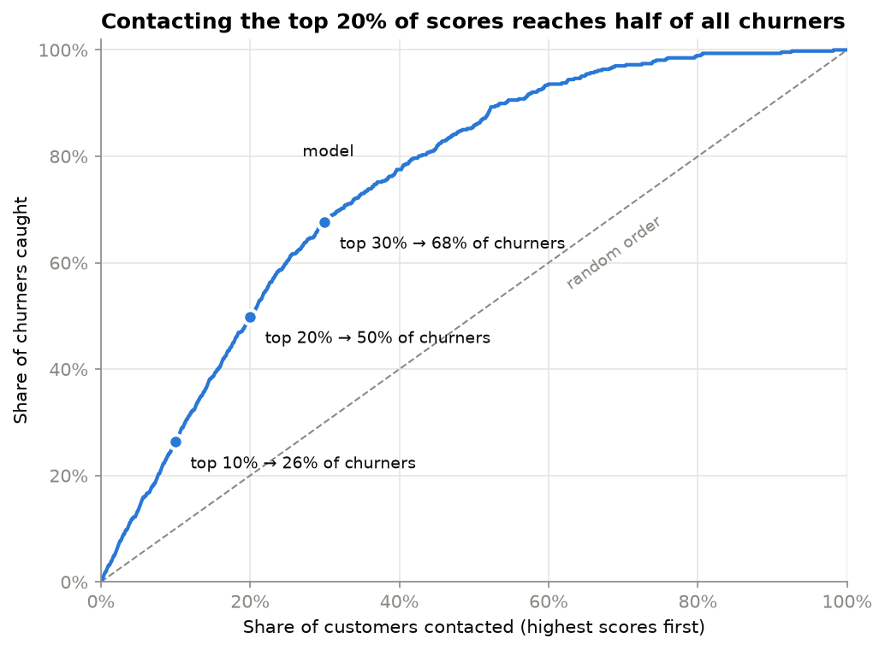
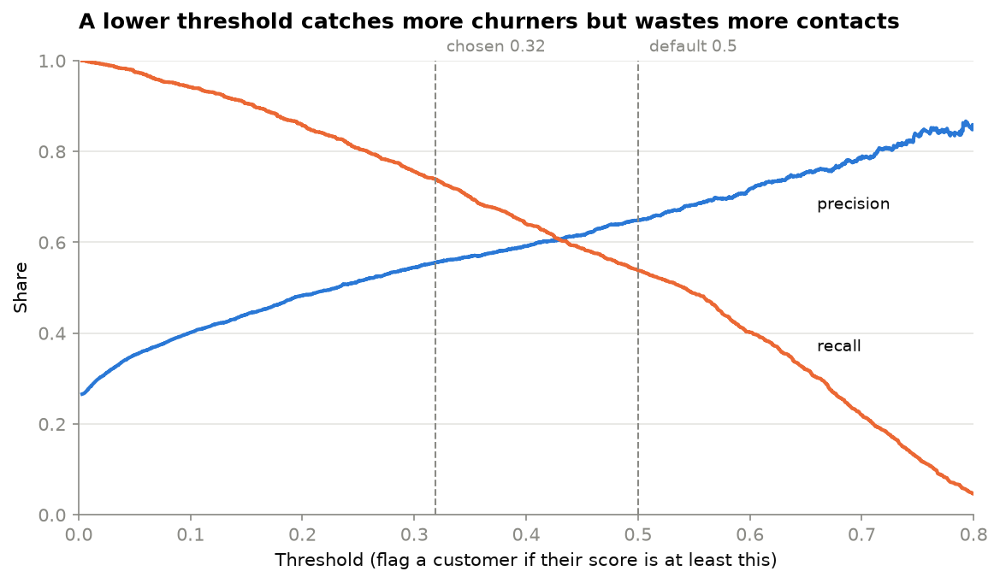
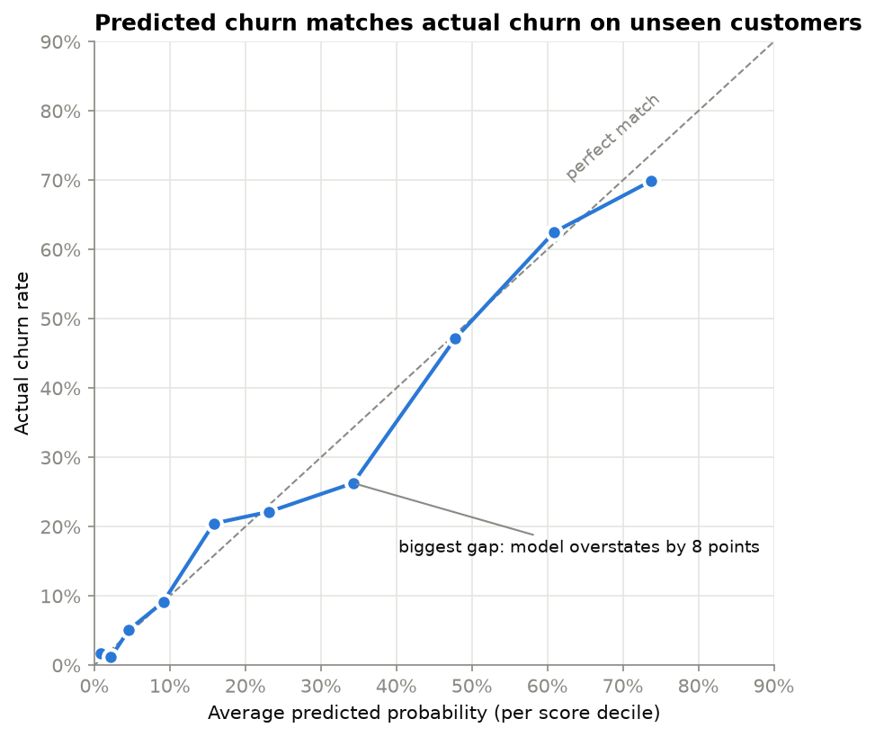
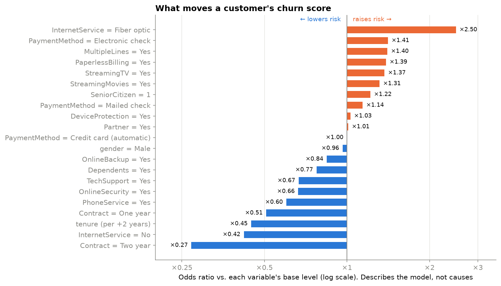
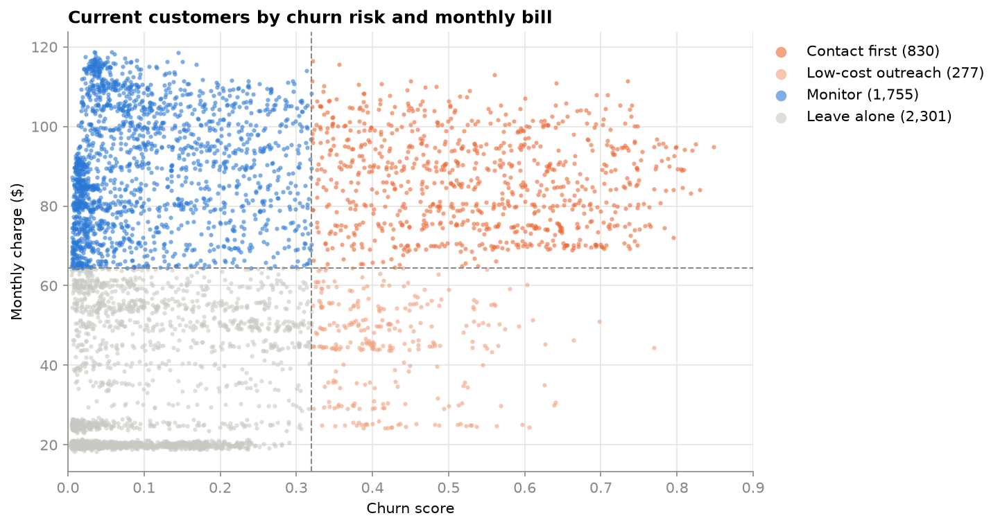
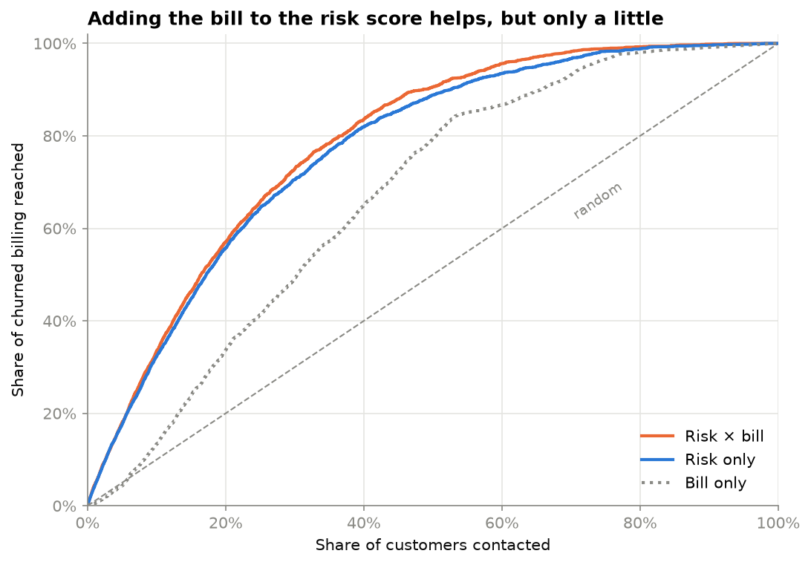

# Churn Intelligence — Telco Customer Retention

Which telecom customers are leaving, what they have in common, who is likely to
leave next, and who the company should contact first.

> **Status:** Stages 1–6 analysis done. Next: Tableau dashboard and final write-up.

---

## The questions

1. **Who is churning?**
2. **What is churn linked to?** (linked, not caused)
3. **Who is likely to churn?** (a model that scores each customer)
4. **Who should we contact first?** (risk combined with customer value)

A model can say who is likely to leave. It can't say whether an offer will make
them stay. That needs a real test.

---

## Data

**IBM Telco Customer Churn**: 7,043 customers, 21 columns, one row per customer.
**26.5% churned** (1,869 customers).

The raw file isn't committed. To run the project, put `telco_customer_churn.csv`
in `data/raw/`.

### Cleaning

Full details are in [`docs/data_dictionary.md`](docs/data_dictionary.md).

| Issue | What we did |
|---|---|
| `TotalCharges` had 11 blank values | Set them to 0. These customers are brand new (tenure 0), so 0 is correct |
| Those 11 new customers | Left out of the model. They can't have churned yet |
| "No internet service" repeats `InternetService = No` | Merged into "No" when modeling |
| `SeniorCitizen` stored as 0/1 | Treated as a category, not a number |
| `TotalCharges` overlaps with tenure and monthly charges | Not used in the model |

---

## Setup

```bash
python3 -m venv .venv
source .venv/bin/activate
pip install -r requirements.txt

python src/validate_raw.py   # check the raw file
python src/clean_data.py     # build data/processed/telco_clean.csv
python src/train_model.py    # train and save the model
```

Run the cleaning script before opening the notebooks.

---

## Project layout

```
data/raw/          raw data (not committed)
data/processed/    cleaned data (not committed)
notebooks/         analysis notebooks
src/               scripts
dashboard/         dashboard files
reports/figures/   charts
```

---

## Roadmap

- [x] 1. Setup and data checks
- [x] 2. Cleaning
- [x] 3. Exploratory analysis ([notebook](notebooks/02_exploratory_analysis.ipynb))
- [x] 4. Modeling ([notebook](notebooks/03_modeling.ipynb))
- [x] 5. Evaluation ([notebook](notebooks/04_evaluation.ipynb))
- [x] 6. Priority list ([notebook](notebooks/05_prioritization.ipynb))
- [ ] 7. Dashboard and final findings

---

## Findings

Everything below shows which traits go **together** with churn, not what causes it.

### Who churns


| Group | Lowest churn | Highest churn |
|---|---|---|
| Tenure | 49–72 months: 9.5% | 1–6 months: 53.3% |
| Contract | Two year: 2.8% | Month-to-month: 42.7% |
| Internet | None: 7.4% | Fiber optic: 41.9% |
| Payment | Credit card: 15.2% | Electronic check: 45.3% |
| Online security | Has it: 14.6% | Doesn't: 41.8% |

- **Highest-risk group:** month-to-month + fiber optic. 54.6% churn, and it's 30% of all customers.
- **Contract matters more than loyalty.** Long-time month-to-month customers still churn at 26%, versus 3% on two-year contracts.

### What doesn't matter much


With 7,000 customers almost everything looks "statistically significant", so we
ranked variables by how **big** the difference is.

- **Gender:** no difference (26.2% vs 26.9%).
- **Multiple lines** and **streaming:** tiny differences.
- **Add-on services** (security, backup, etc.) look very protective, but partly
  because customers who have them also tend to be long-term and on contracts.
- **Payment:** only electronic check stands out. Mailed check looks like the automatic methods.

### Billing from churned customers


Churned customers were 26.5% of customers but **30.5% of monthly billing**
($139K of $456K). Month-to-month + fiber accounts for **72%** of that, mostly
because it's a big group with high prices.

### What this data can't tell us

Fiber customers churn much more than DSL customers (42% vs 19%). But they also pay
more, use electronic check more, and are more often month-to-month. The data
can't tell whether the cause is price, service quality or competitors.

### Modeling

| Model | Precision | Recall | ROC-AUC |
|---|---|---|---|
| Rule: flag all month-to-month | 0.43 | 0.89 | — |
| **Logistic regression** (chosen) | 0.65 | 0.54 | **0.844** |
| Gradient boosting | 0.66 | 0.53 | 0.850 |

- **Accuracy is misleading here.** Guessing "nobody churns" scores 73%.
- **Logistic regression won.** Gradient boosting was barely better, and logistic regression is easier to explain.
- **Monthly charges dropped.** It's just the sum of the services a customer has, so it added nothing new.

### Results on unseen customers

The model was tested once on 1,758 customers it never saw. **ROC-AUC 0.839**
(likely range 0.82–0.86), almost the same as in training (0.844), so no overfitting.

**Who to contact first.** Ranking customers by score and working down the list:



| Contact the top… | Share of them who churn | Share of all churners found |
|---|---|---|
| 10% | 70% | 26% |
| 20% | 66% | 50% |
| 30% | 60% | 68% |

Contacting the top 20% reaches **half of all churners**, versus 20% by random choice.

**Picking a threshold.** At 0.32 instead of the default 0.5, the model catches
**74%** of churners instead of 57%, but contacts more customers who would have
stayed. The right threshold depends on what a lost customer costs versus a wasted
contact.



**The scores can be read as percentages.** Predicted churn matches actual churn
within 5 points in 9 of 10 score bands.



**What moves the score.** Fiber optic, electronic check and paperless billing push
it up. Two-year contracts, long tenure, online security and tech support pull it
down.



Ignore streaming and multiple lines here. They raise the score because they cost
extra, so they stand in for price. They aren't a cause of churn.

**Who the model misses.** The 120 churners it didn't flag look like customers who
stay: median tenure 24 months (vs 7 for caught churners), 40% on one- or two-year
contracts, and a quarter with no internet. It misses **48 of the 53** contract
churners. Nothing in this data separates a contract customer who will leave from
one who will stay; that would need signals like complaints or contract end dates.

### Who to contact first

This is a **ranking system, not proof that contacting customers prevents churn.**

Every current customer (5,163) gets a churn score and a **monthly bill at risk =
score × monthly bill**. It's a ranking number, not a dollar loss (there's no
profit data). Customers are ranked by it and split into four groups, using the
Stage 5 score cutoff (0.32) and the median bill ($64.45) as a simple business rule:



| Group | Customers | Share of bill at risk |
|---|---|---|
| **Contact first** (high risk, high bill) | 830 | **57%** |
| Low-cost outreach (high risk, low bill) | 277 | 8% |
| Monitor (low risk, high bill) | 1,755 | 24% |
| Leave alone (low risk, low bill) | 2,301 | 11% |

**Risk × bill vs risk alone is a small trade-off** (top 20% of customers):

| Ranking | Churners caught | Churned billing reached |
|---|---|---|
| Risk only | **50.8%** | 55.9% |
| Risk × bill | 48.8% | **57.1%** |
| Simple rule (month-to-month fiber, highest bill first) | 39.5% | 49.5% |



- Adding the bill reaches 1.3 points more billing but catches 2 points fewer
  churners. It's small, because risky customers here already pay more.
- The model clearly beats the simple rule for short lists. At 30% of customers
  they nearly tie.
- **The top 500 are all fiber** (97% month-to-month). That's expected: fiber
  raises both the risk score and the bill, and no DSL customer ranks above 537.

The full list is in [`dashboard/data/priority_list.csv`](dashboard/data/priority_list.csv).
Before acting on it, test offers on a random half of "Contact first" and compare
churn with the other half.

### Main limitation

The data is a single snapshot with no dates. The model spots customers who look
like past churners. It can't predict "who leaves next month". That would need
data with dates.
