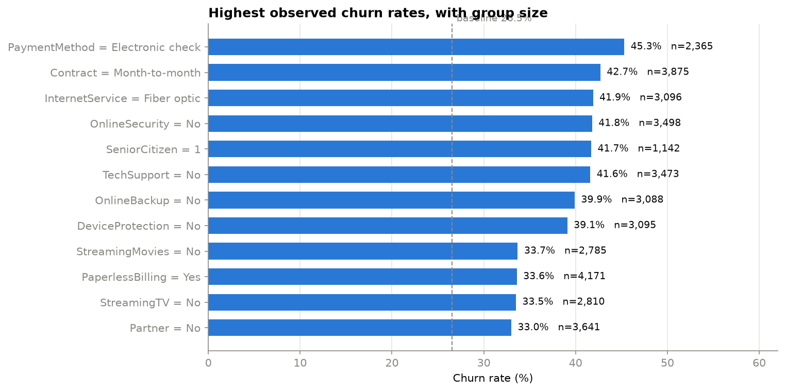
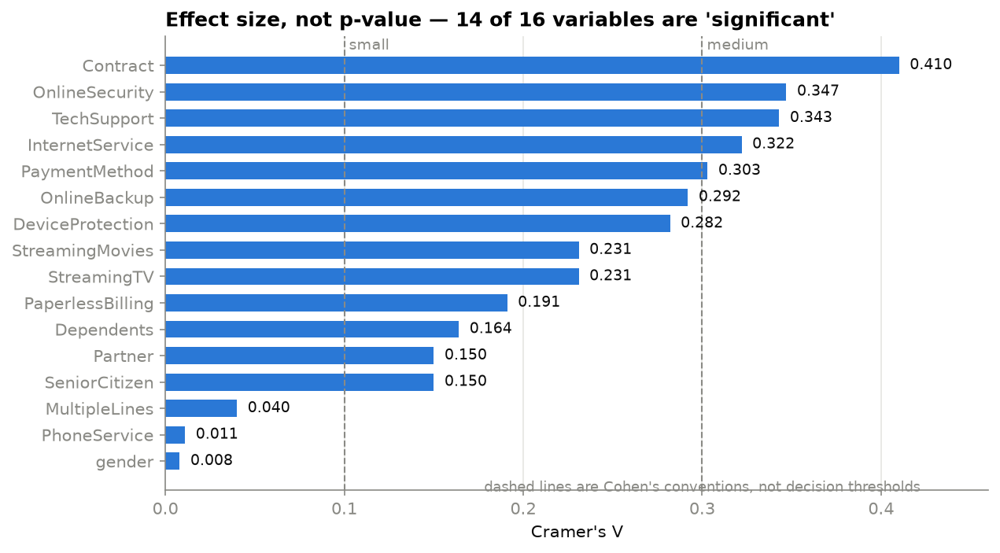
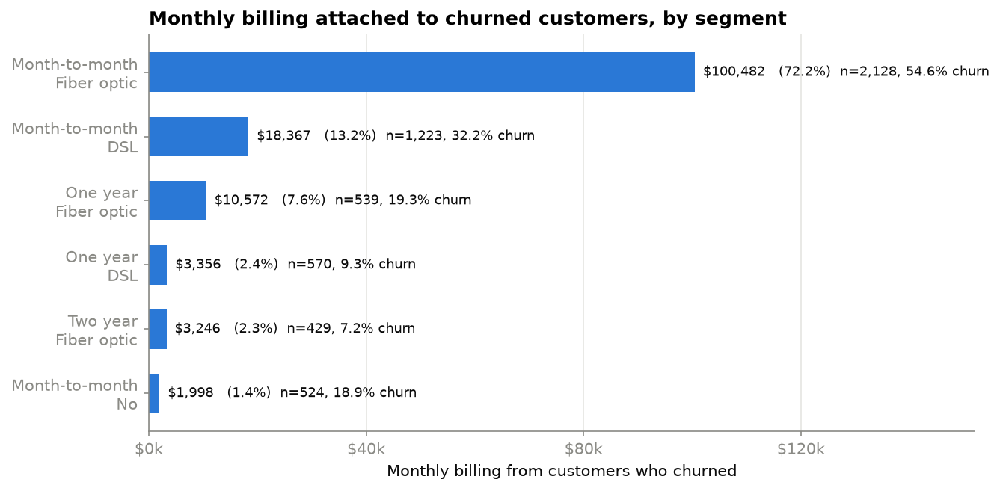

# Churn Intelligence — Telco Customer Retention Analysis

Turning a customer churn dataset into a retention decision: who is leaving, what
that is associated with, who is likely to leave next, and — given limited
retention budget — who the company should actually contact first.

> **Status:** in progress. Stage 2 of 7 complete (data cleaned and documented).

---

## The business question

> How can a telecommunications company understand customer churn, identify
> customers at risk of leaving, and prioritize retention efforts?

Four questions structure the work:

1. **Who is churning?** — churn rates across contract type, tenure, services, payment method.
2. **Why are they churning?** — variables *associated* with churn, stated as association, not cause.
3. **Who is likely to churn?** — a predictive model producing customer-level churn probabilities.
4. **Who should be prioritized?** — churn risk combined with customer value, with the assumptions made explicit.

A churn model predicts *who leaves*. It does not prove that any retention offer
will change that. Interventions discussed in this project are treated as
**hypotheses to be tested by experiment**, not as established facts.

---

## Data

**IBM Telco Customer Churn** — the standard 21-column version.

- 7,043 customers, one row each, `customerID` unique
- Target: `Churn` (Yes/No)
- **Baseline churn rate: 26.54%** (1,869 churned / 5,174 retained)

The raw file is **not committed** (see `.gitignore`). To reproduce, place
`telco_customer_churn.csv` in `data/raw/` and run the validation script below.

### Data quality issues and how they were handled

Full evidence and reasoning for each decision is in
**[`docs/data_dictionary.md`](docs/data_dictionary.md)**.

Cleaning fixes what is **wrong** and changes nothing else. Of the four issues
investigated, only one was a data-quality problem; the rest are questions about how
to *represent* the data for a model, and are deferred to the Stage 5 preprocessing
pipeline where they can be fitted on training data and swapped freely.

| Issue | Detail | Resolution |
|---|---|---|
| `TotalCharges` is text | 11 rows contain a blank string, forcing the column to load as text | **Fixed** — set to `0.0`. These are exactly the `tenure = 0` rows, so zero is the true value, not an estimate |
| Those 11 rows | All `Churn = No`, and no customer with `tenure = 0` *can* be labelled churned — their label is definitional, not observed | Kept; flagged for possible exclusion from model training in Stage 5 |
| Redundant category labels | `"No internet service"` is bit-identical to `InternetService = "No"` across six columns — naive one-hot encoding yields 7 duplicate dummies | **Kept as-is.** An encoding decision, not a data-quality one — deferred to Stage 5 |
| `SeniorCitizen` coded `0/1` | Would be picked up by dtype-based column routing and scaled as a numeric feature | **Kept as-is.** Fixed in Stage 5 by naming columns explicitly instead of inferring from dtype |
| `TotalCharges` collinearity | `R² = 0.895` against `tenure + MonthlyCharges` (VIF 9.5); flips sign when fitted alongside them | **Kept as-is** — deferred to Stage 5 |
| Class imbalance | 26.5% positive class — accuracy is a misleading metric here | Stages 5–6 |

---

## Setup

```bash
python3 -m venv .venv
source .venv/bin/activate
pip install -r requirements.txt

python src/validate_raw.py   # verifies the raw file matches the expected schema
```

---

## Repository structure

```
data/raw/          raw dataset (not committed)
data/processed/    cleaned outputs (not committed, rebuilt by script)
notebooks/         exploratory analysis
src/               reusable scripts
dashboard/         Power BI / Tableau files
reports/           figures and written findings
```

---

## Roadmap

- [x] **1. Foundation & data validation** — environment, repo scaffold, schema checks
- [x] **2. Cleaning & data dictionary** — one data fix; representation decisions deferred
- [x] **3. EDA & business analysis** — who is churning, statistical testing, revenue at risk
- [ ] **4. Feature engineering & modeling** — logistic regression, then a tree-based model
- [ ] **5. Evaluation, interpretation & threshold selection**
- [ ] **6. Retention prioritization, dashboard & findings**

---

## Findings so far

Baseline churn rate: **26.54%** (1,869 of 7,043 customers).
Full analysis in [`notebooks/02_exploratory_analysis.ipynb`](notebooks/02_exploratory_analysis.ipynb).

All statements below describe **association**, not cause. This is observational
data — customers chose their own contracts, plans and payment methods.

### Who is churning



| Variable | Range | Spread |
|---|---|---|
| `tenure` | 49–72 months 9.5% → 1–6 months 53.3% | 43.8pp |
| `Contract` | Two year 2.8% → Month-to-month 42.7% | 39.9pp |
| `InternetService` | No internet 7.4% → Fiber optic 41.9% | 34.5pp |
| `PaymentMethod` | Credit card 15.2% → Electronic check 45.3% | 30.1pp |
| `OnlineSecurity` (internet subscribers) | has it 14.6% → lacks it 41.8% | 27.2pp |

The sharpest segments combine variables: **month-to-month + fiber optic churns at
54.6% across 2,128 customers** — 30% of the customer base in a single high-risk
group. Tenure does not offset contract type: month-to-month customers of 49–72
months still churn at 26.0%, versus 3.3% for two-year customers of equal tenure.

### Effect size, not p-value



With n = 7,043, **14 of 16 variables reach p < 0.05** — so p-values alone would
report fourteen findings. Cramér's V reduces that to a usable handful, and
Bonferroni correction (α = 0.003125, for 16 tests) leaves **13**.

`MultipleLines` is the cautionary case: p = 0.0035 clears the naive bar, **fails
the correction**, and carries a 3.7pp spread that no retention budget should act
on. The 0.1/0.3/0.5 labels on the chart are Cohen's conventions, not decision
thresholds — the notebook ranks by V but judges by churn-rate spread.

### Notable negative findings

- **`gender` shows no association** — 26.2% vs 26.9%, V = 0.008, p = 0.487.
- **`MultipleLines`: p = 0.0035, V = 0.040.** Significant by the naive bar, fails
  Bonferroni, and practically irrelevant either way.
- **Streaming services carry essentially no association.** Among internet subscribers
  the gap is only 3.4pp, and in the *protective* direction. Their Cramér's V of 0.231
  is an artefact of the `"No internet service"` level standing in for `InternetService`,
  not a streaming effect.
- **The protective-services gradient is substantially tenure and contract in disguise.**
  Churn slides 56.7% → 5.3% across the count of protective add-ons held — but customers
  holding none have a median tenure of 7 months and are 94.9% month-to-month, while
  those holding all four are at 70 months and 7.2%. Holding contract constant, the
  spread falls from 51.4pp to 35.6pp (58.5% → 22.9%). A substantial association
  remains; about a third of the headline spread does not.
- **Payment method is not "automatic vs manual".** Mailed check (31.6%) sits with
  the automatic methods, not with electronic check (53.7%). Electronic check
  specifically is the outlier.
- **The `MonthlyCharges` relationship flattens at the top rather than reversing.**
  Q4 36.1% vs Q5 32.8% is not statistically distinguishable (p = 0.065).

### Billing associated with churn



Churned customers are **26.5% of the base but 30.5% of monthly billing**
(\$139,131 of \$456,117). **Month-to-month + fiber optic accounts for 72.2%** of the
billing attached to churned customers.

That 72.2% reflects **size, rate and price together**, and size does much of the
work: 30.2% of customers → 62.2% of churners → 72.2% of churned billing. It is not
evidence that the segment churns far more than every other — month-to-month +
electronic check runs at nearly the same rate on a smaller, cheaper base.

The quantity is `MonthlyCharges × churn`, summed: **monthly billing that was being
collected from customers who have since left**. Historical and descriptive — not
lost revenue, profit, or a recovery target.

### What this analysis cannot establish

Fiber customers churn at 41.9% vs 19.0% for DSL, and the gap persists in all **9**
of the 12 contract × payment strata large enough to read (≥100 customers in both
groups), by 1.8 to 25.8 points. But fiber customers also differ systematically in
contract mix (68.7% month-to-month vs 50.5%), payment method (51.5% electronic
check vs 26.8%) and price (\$91.68 vs \$56.15 median).

Whether the cause is price, service quality, or local competition **cannot be
separated with this dataset** — price and product are perfectly bundled, and
quality and competition are not measured at all. Stratifying on observed variables
is not the same as controlling for confounding.

Every "we should offer X to segment Y" idea remains a hypothesis requiring an
experiment.

### A limitation that shapes Stage 4

This dataset is a **snapshot**. Every column is measured at one moment and `Churn`
means *left within the last month* — there is no observation window, event date or
"as of" timestamp, so the data has **no defined prediction point**.

A model built on it learns to separate customers who have already churned from
those who have not, using their current attributes. That is legitimate risk
scoring, and it is what this data supports — but it is not forecasting, and its
output should not be described as "probability of churning next month". A
production version would need event timestamps and an explicit prediction window.
